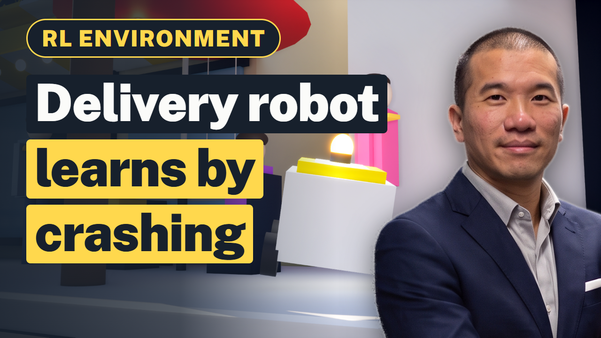

# Delivery Robot RL Environment in Unreal Engine: Sidewalk Pizza Delivery Demo

A sidewalk delivery robot learns, by trial and error, to bring a pizza from the shop to a customer across the street. First try: it bumps into everything. After practice: a clean delivery.

This is an open **last-mile delivery reinforcement learning (RL) environment** built in **Unreal Engine 5**: a sidewalk delivery robot carrying a pizza
practises one job, every try is scored by a reward function, and the score teaches it what works. It covers
sidewalk delivery robots, obstacle avoidance and last-mile route planning. The full walkthrough is on YouTube ([Delivery Robot RL Environment in Unreal Engine](https://www.youtube.com/watch?v=thywTO-ZU2E)), and the
[slides with the full transcript](https://aitrainingdatabroker.com/slides/rl-environment-pizza-delivery-robot/?utm_source=github&utm_campaign=rl-environment-delivery-robot-unreal) explain each step in plain words.

## What is an RL environment?

Reinforcement learning means software learns a job by trying, and every try gets a score. An RL environment is the
practice world where those tries happen: a task, many tries, and a reward function that grades each one. When the
world copies a real place closely enough, people also call it a digital twin or a simulator.

## The world

One city street with a pizza shop, parked cars, people on the sidewalk and the customer at a yellow door. This world was built inside Epic's Third Person template level, whose content cannot be republished, so this repo has the scripts and the reasoning but not the Unreal files.

## Reward function

| Event | Score |
|---|---|
| Every step closer to the door | points |
| Delivered | +20 |
| Bump | -30 |
| Wasted second | small cost |

## How it was built

`gen.py` holds the robot's waypoints for each run (first try, practice, after practice) and the camera moves; `overlay.py` draws the delivery scorecard and the ROBOT ring on the top-down shot.

The run is pre-programmed on a Sequencer timeline (`LS_Demo`) and rendered with Unreal's built-in sequence capture.
The scorecard is drawn afterwards in Python, so a text fix never needs a re-render.

## Why last-mile delivery companies build RL environments

A private simulator lets a company practise a costly or risky job without touching real equipment: last-mile delivery robots, sidewalk safety testing, and route planning.
What makes a simulator realistic is the company's own operating data: GPS traces, delivery times, route and incident records. That data can stay in-house
to train a private model, or be licensed to an AI lab after it is de-identified, with the contract setting the limits.
How that works for companies building rl environments is explained at [AITrainingDataBroker.com](https://aitrainingdatabroker.com/sell/rl-environments/?utm_source=github&utm_campaign=rl-environment-delivery-robot-unreal).

## What is in this repo

The Python that drives the run (`scripts/gen.py`: waypoints, cameras and timing) and draws the scorecard
(`scripts/overlay.py`), plus the sign art sources. The Unreal level itself is not included: it was built inside Epic's
Third Person template, whose content cannot be republished. The newer demos linked below include their full Unreal projects.

## More RL environment demos

- [Trucking RL Environment in Unreal Engine: Trailer Docking Demo](https://github.com/aitrainingdatabroker/rl-environment-trucking-trailer-docking-unreal)
- [Construction RL Environment in Unreal Engine: Tower Crane Lift Demo](https://github.com/aitrainingdatabroker/rl-environment-tower-crane-construction-unreal)
- [Manufacturing RL Environment in Unreal Engine: Robot Arm Bin Picking Demo](https://github.com/aitrainingdatabroker/rl-environment-factory-robot-arm-unreal)
- [MLP in RL, Explained with a Grocery Store: Milk Reorder Demo in Unreal Engine](https://github.com/aitrainingdatabroker/mlp-rl-grocery-reorder-unreal)

## About

Made by [AI Training Data Broker](https://aitrainingdatabroker.com/?utm_source=github&utm_campaign=rl-environment-delivery-robot-unreal), a broker and technical advisor for companies licensing their
operating data to AI labs. Code and our own assets are MIT licensed (see `LICENSE`). The world is a demo built for
illustration: a production RL environment needs more training, testing and real operational data. General information,
not legal advice.
